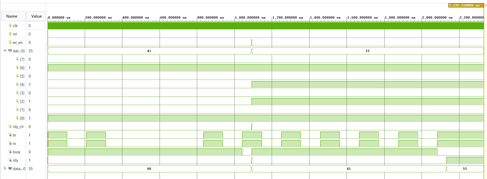

# UART Implementation Using Verilog HDL and Xilinx Vivado

## Overview

This project implements an 8-bit UART transmitter and receiver using Verilog HDL. The design is simulated in Xilinx Vivado and uses a 50 MHz system clock with a nominal baud rate of 9600 bps.

The UART uses the **8N1 frame format**: one start bit, eight data bits, no parity bit, and one stop bit. Data is transmitted least-significant bit (LSB) first.

## Design Architecture

The project contains four RTL modules:

| Module | Description |
|---|---|
| `baud_rate_generator.v` | Generates clock-enable pulses for the transmitter and receiver. |
| `transmitter.v` | Converts an 8-bit parallel input into a serial UART frame. |
| `receiver.v` | Samples the serial input and reconstructs the 8-bit data. |
| `uart_top.v` | Connects the baud-rate generator, transmitter, and receiver. |

The testbench, `uart_tb.v`, connects the transmitter output (`tx`) directly to the receiver input (`rx`) to verify the design through loopback communication.

## Baud Rate Generation

The baud-rate generator uses the 50 MHz system clock and two counters to generate enable pulses. These are clock-enable signals, not separate clocks; all modules continue to use the main system clock.

- **Transmitter:** The counter runs from 0 to 5207, producing an enable frequency of approximately 9600.61 Hz.
- **Receiver:** The counter runs from 0 to 324, producing an enable frequency of approximately 153846.15 Hz.

The receiver enable frequency is approximately 16 times the nominal 9600 baud rate, allowing the receiver to sample the serial input at a faster rate.

$$
f_{\text{tx\_enb}} = \frac{50,000,000}{5208}
\approx 9600.61\ \text{Hz}
$$

$$
f_{\text{rx\_enb}} = \frac{50,000,000}{325}
\approx 153846.15\ \text{Hz}
$$

## Transmitter and Receiver Operation

### Transmitter

The transmitter uses a finite state machine (FSM) to control the transmission process. When `wr_en` is asserted while the transmitter is idle, it stores `data_in` and begins sending a UART frame.

It sends the start bit low, followed by the eight data bits in LSB-first order. Each bit is advanced by the `tx_enb` enable pulse. The transmitter then sends the stop bit high and returns to the idle state. The `busy` output indicates when the transmitter is active.

### Receiver

The receiver uses an FSM and a 4-bit sample counter. In the start state, it monitors `rx` and increments the sample counter when the input is low. When the counter reaches the start-detection threshold, the receiver moves to data reception.

During data reception, it samples one bit after each 16 receiver-enable events and stores the bit in an 8-bit temporary register, starting at bit 0 (LSB). After all eight bits have been sampled, it waits through the stop-bit interval, copies the temporary byte to `data_out`, and asserts `rdy`.

The `rdy` signal remains asserted until `rdy_clr` or reset clears it.

**Current implementation note:** The receiver does not clear the start-detection sample counter when `rx` returns high. Therefore, the start detection does not guarantee eight consecutive low samples. The receiver also does not check that `rx` is high during the stop-bit interval; `rdy` indicates completion of the receive sequence, not stop-bit validation.

## Simulation and Verification

The testbench generates a 50 MHz clock (20 ns period), applies reset, and tests two data values using internal loopback:

| Test | Transmitted byte | Expected received byte |
|---|---|---|
| 1 | `8'h41` | `8'h41` |
| 2 | `8'h55` | `8'h55` |

The testbench waits for `rdy`, compares `data_out` with the transmitted byte, and prints a PASS or FAIL message in the Vivado simulation console.

## Simulation Waveform

The waveform below shows the UART loopback simulation. The `tx` and `rx` signals carry the same serial data because they are directly connected in the testbench. The received byte appears on `data_out`, and `rdy` indicates that reception has completed.



## Project Structure

```text
UART_Implementation_Using_Verilog_and_Vivado/
│
├── rtl/
│   ├── baud_rate_generator.v
│   ├── transmitter.v
│   ├── receiver.v
│   └── uart_top.v
│
├── tb/
│   └── uart_tb.v
│
├── images/
│   └── uart_waveform.png
│
└── README.md
```

## Running the Project in Vivado

1. Open Xilinx Vivado and create an RTL project.
2. Add the Verilog files from the `rtl/` folder as design sources.
3. Add `tb/uart_tb.v` as a simulation source.
4. Set `uart_tb` as the simulation top module.
5. Run **Run Simulation → Run Behavioral Simulation**.
6. Observe the UART signals in the waveform window and check the Tcl console for the test results.

## Notes and Possible Improvements

- The design uses an active-high synchronous reset.
- The generated transmitter and receiver enable rates are approximate; they are not an exact 16:1 ratio.
- Add a reset of the receiver's start-detection counter when `rx` is high.
- Validate the stop-bit level and add framing-error detection.
- Add an input synchronizer for an external asynchronous RX signal.
- Test more data patterns and back-to-back frames.
- For FPGA hardware use, add the appropriate XDC pin constraints and verify the design on the target board.

## Conclusion

This project demonstrates a basic UART communication system in Verilog, including baud-rate enable generation, FSM-based serial transmission and reception, and loopback verification in Vivado. The testbench checks that the receiver reconstructs the two transmitted test bytes, `8'h41` and `8'h55`.